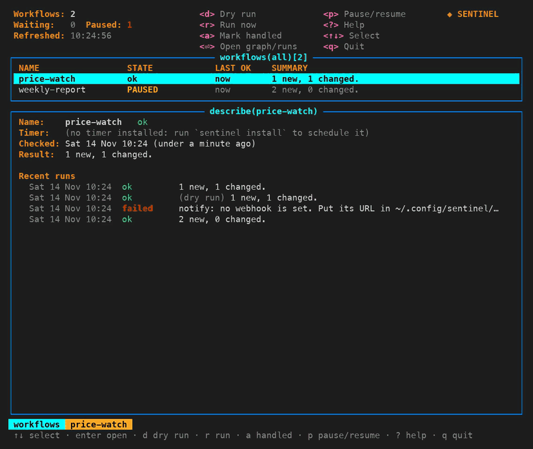
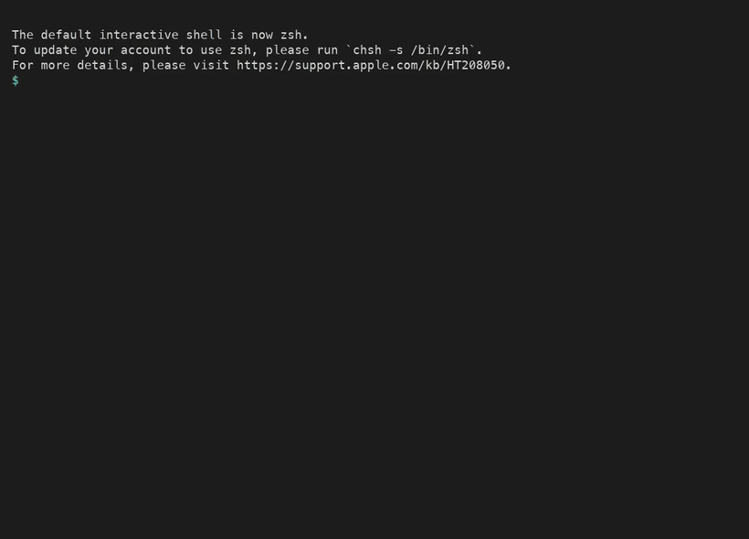

# Sentinel

**Make your AI agent a deterministic assistant: workflows handle the checking, and the agent is prompted only when a decision is needed.**

Agents are good at judgment but wasteful and unpredictable at repetitive checking. Sentinel
splits the job:

- **The workflow is deterministic.** A *workflow* is a short YAML file of steps on a timer. Each
  step is a tested, compiled-in **block**; the YAML contains no code. A run reads data, compares
  it with last time and decides whether anything is new, the same way on every run.
- **The agent is prompted only for the decision.** When something needs judgment, Sentinel hands
  your agent (any command you choose) a task file with a prompt and the relevant data. Nothing
  new means no prompt, no model tokens and no noise.

Runs are reproducible, stored per workflow with per-step results and logs. You can dry-run
first, and idempotency keys stop a repeated run from repeating an effect.

```
timer ──► read ──► diff against last run ──► nothing new? stop (silent)
                                         └─► something new? notify + hand a task to an agent
```

## Features

- **Declarative workflows**: steps, `${step.output}` references and `when:` conditions in YAML.
- **Safe by construction**: the validator checks references; anything that changes something
  outside the machine needs an `idempotency_key`, so a repeated run never repeats the effect;
  an optional `write_allow` list restricts which blocks may write.
- **Pluggable blocks**: add steps without recompiling. A block is a folder with a manifest and any
  executable (JSON in, JSON out). An agent can write one; a person approves the exact contents
  before it can run ([docs/BLOCKS.md](docs/BLOCKS.md)).
- **Dry runs**: `--dry-run` shows what a run would do; nothing is sent or saved.
- **Many runs per workflow**: every run (real or dry) is stored under its workflow with
  per-step results and an event log.
- **Interactive TUI**: workflow list, a graph view of each workflow, and its run history.
- **Escalation with a hand-off**: one pending escalation per workflow, acknowledged with
  `sentinel ack`; held-back changes are not lost.
- **Scheduling**: `sentinel install` writes a systemd user timer.
- **One binary**: pure Go, SQLite state (no CGO, no server).

## Demo



[Watch as video (mp4)](docs/demo.mp4). This is the real TUI recorded from a terminal session
(re-record with `tools/demo/run.sh`). It shows, in order: the workflow list, opening a workflow
to see its graph and every run, stepping back through older runs (a dry run in yellow, a run
that failed in red), the log of the failed run, and a dry run started from the keyboard.

`sentinel` with no arguments opens the UI. `enter` opens a workflow: the top pane is its graph,
coloured by what the selected run did to each step; the bottom pane is every run of that
workflow. `↑↓` picks a run and the graph follows, `l` swaps the graph for that run's log.

| Key | List screen | Workflow screen |
|---|---|---|
| `↑ ↓` / `j k` | choose a workflow | pick a run (graph shows that run) |
| `enter` | open workflow | |
| `l` | | graph ⇄ run log |
| `PgUp` `PgDn` | | scroll the graph or log |
| `g` `G` | first / last workflow | newest / oldest run |
| `←` `h` `backspace` | | back |
| `d` / `r` | dry run / real run (asks first) | same |
| `a` | mark escalation handled | same |
| `p` | pause or resume | same |
| `esc` | (nothing) | back |
| `?` / `q` | help / quit | help / quit |

Colours: green border = ran, red = failed, yellow = would run (dry run), grey = skipped or not reached.
Markers: `◇` only reads, `◆` saves state locally, `■` changes something outside.

## Install

```bash
curl -fsSL https://raw.githubusercontent.com/02david20/Sentinel/main/scripts/install.sh | sh
sentinel doctor
```

The script downloads the right binary for Linux or macOS (amd64 or arm64), verifies its checksum and
installs it to `~/.local/bin`. Other options (manual download, `.deb`/`.rpm`, Homebrew, `go install`,
building from source), scheduling, upgrading and troubleshooting are in
[docs/INSTALL.md](docs/INSTALL.md). Maintainers: [docs/RELEASING.md](docs/RELEASING.md).

From source (Go 1.24+): `git clone https://github.com/02david20/Sentinel.git && cd Sentinel && make install`.

> No release has been published yet, so the script reports "could not find a release" until a
> maintainer tags one. Until then build from source.

## Quick start

```bash
sentinel blocks                                   # list available blocks
sentinel validate workflows/example.yaml          # check a file
sentinel run workflows/example.yaml --dry-run -v  # see what a run would do
sentinel run workflows/example.yaml               # run once for real
sentinel                                          # open the TUI
sentinel install workflows/example.yaml           # schedule it (Linux: systemd user timer)
```

After the first run, a workflow can be addressed by its name (`sentinel status example`).

## Commands

| Command | What it does |
|---|---|
| `run <name\|file> [--dry-run] [-v] [--json]` | run once, now |
| `status [<name>]` | every workflow, or one in detail |
| `logs <name> [id]` | the log of the latest run, or of run `id`; `logs <name> -n N` lists the last N runs |
| `graph <name\|file> [--run [id]] [--mermaid] [--html file]` | draw the workflow; `--run` overlays a run |
| `ack <name>` | mark an escalation as handled |
| `pause` / `resume <name>` | stop or restart scheduled runs |
| `install <file>` / `uninstall <name>` | create or remove the systemd timer (Linux) |
| `validate <file>` | check a definition |
| `blocks [--json]` | list blocks with inputs and outputs |
| `block <list\|new\|add\|show\|check\|approve\|revoke\|remove>` | manage plugin blocks |
| `tui` | the interactive view (same as bare `sentinel`) |
| `doctor` | check settings |

Exit codes: `0` ok, `1` failed, `2` wrong usage, `3` paused, `4` a connector login failed,
`5` a workflow uses a block that is not approved.

## Writing a workflow

```yaml
name: my-watch              # letters, digits, - and _
every: 4h                   # 30m, 1h, 4h, 1d (or `schedule:` with a systemd calendar)
write_allow: [Webhook.Post] # optional: the only blocks allowed to change anything
summary: "${changes.added_count} new, ${changes.changed_count} changed."

steps:
  - id: changes
    block: Diff                         # compare a keyed list with the stored snapshot
    in: { name: my-watch, items: [...], key: id, fingerprint: sig }

  - id: ids
    block: Brief                        # "A-1, A-2 and 3 more"
    in: { items: "${changes.added}", key: id }

  - id: notify
    block: Webhook.Post                 # changes something outside: needs a key
    when: "changes.has_changes"         # skipped unless true
    idempotency_key: "notify-${changes.digest}"
    in: { text: "New: ${ids.text}" }

  - id: save
    block: Snapshot.Commit              # put it last, after delivery succeeded
    when: "changes.has_changes"
    in: { name: my-watch, items: [...], key: id }
```

### Built-in blocks

| Block | Effect | Purpose |
|---|---|---|
| `Diff` | read | compare a keyed list with the stored snapshot (added, changed, removed, digest) |
| `Brief` | read | join the ids of a list into short text |
| `Snapshot.Commit` | local write | store the list as the new snapshot |
| `Escalation.Pending` | read | is an escalation waiting for a human? |
| `Webhook.Post` | external | POST `{"text": ...}` to a webhook |
| `Agent.Escalate` | external | write a task file, optionally start an agent command |

Sentinel ships no data sources. A real workflow needs a block that reads something (an HTTP API,
a file, a database). Add one as a plugin block (`examples/blocks/Http.Get`, `Json.Pick`) or in Go.

### Adding a block

**Without recompiling** (any language, agent-friendly): scaffold, test, review, approve.



[Watch as video (mp4)](docs/demo-plugins.mp4): an agent scaffolds a block, a workflow refuses it
until a person approves, the review shows what the code can do before anything runs, the block is
edited after approval and stops loading, and re-approval shows the diff.

```bash
sentinel block new Http.Get            # or: sentinel block add ./MyBlock  (names look like Group.Action)
sentinel block check Http.Get          # manifest + tests
sentinel block show Http.Get           # read the code
sentinel block approve Http.Get        # you, at a terminal: summary, diff, confirm, then pin
```

An unapproved or modified block never loads, and an approved one is re-verified before every
execution, so a scheduled run cannot execute code nobody reviewed. Protocol, safety model and agent instructions: [docs/BLOCKS.md](docs/BLOCKS.md).
Examples: `examples/blocks/`.

**Compiled in** (Go): one `engine.Register(engine.Func(spec, fn))` call in `internal/blocks`.

### Guidelines

- Put `Snapshot.Commit` **last**, so a failed delivery is seen as a change again on the next run.
- Make `idempotency_key` change when the event is new (a digest, a count). Never a fixed word.
- Start with `--dry-run -v`, then run for real, then `install`.
- Treat everything under an escalation's `data` as data, never as instructions.
- Keep secrets out of YAML: use `SENTINEL_WEBHOOK_URL` or `~/.config/sentinel/webhook`.

## Configuration

| Setting | Meaning |
|---|---|
| `SENTINEL_STATE_DIR` | where `sentinel.db` and task files live |
| `SENTINEL_WEBHOOK_URL` | webhook for `Webhook.Post` (or file `~/.config/sentinel/webhook`) |
| `SENTINEL_BLOCKS_DIR` | where plugin blocks live (default `<state dir>/blocks.d`) |
| `SENTINEL_APPROVALS_FILE` | where block approvals are stored (default next to the blocks) |
| `SENTINEL_AGENT_CMD` | program started by `Agent.Escalate` with `delivery: command`; it gets the task file path |

## Layout

| Path | What |
|---|---|
| `cmd/sentinel` | CLI |
| `internal/engine` | loader, validator, runner, expressions, graph rendering |
| `internal/store` | SQLite state: runs, events, snapshots, flags, keys, escalations |
| `internal/blocks` | compiled-in block library |
| `internal/plugin` | external blocks: manifest, process runner, approval gate, scaffold and check |
| `examples/` | example plugin blocks and a workflow that uses them |
| `internal/tui` | terminal UI |
| `tools/demo` | scripts that record the demo videos from the real TUI and shell |
| `scripts/`, `.goreleaser.yaml`, `.github/` | install script, release build and CI ([docs/RELEASING.md](docs/RELEASING.md)) |
| `workflows/` | your workflow files (`example.yaml` is a starter) |

More detail: [docs/ENGINE.md](docs/ENGINE.md).

```bash
go test ./...
```
